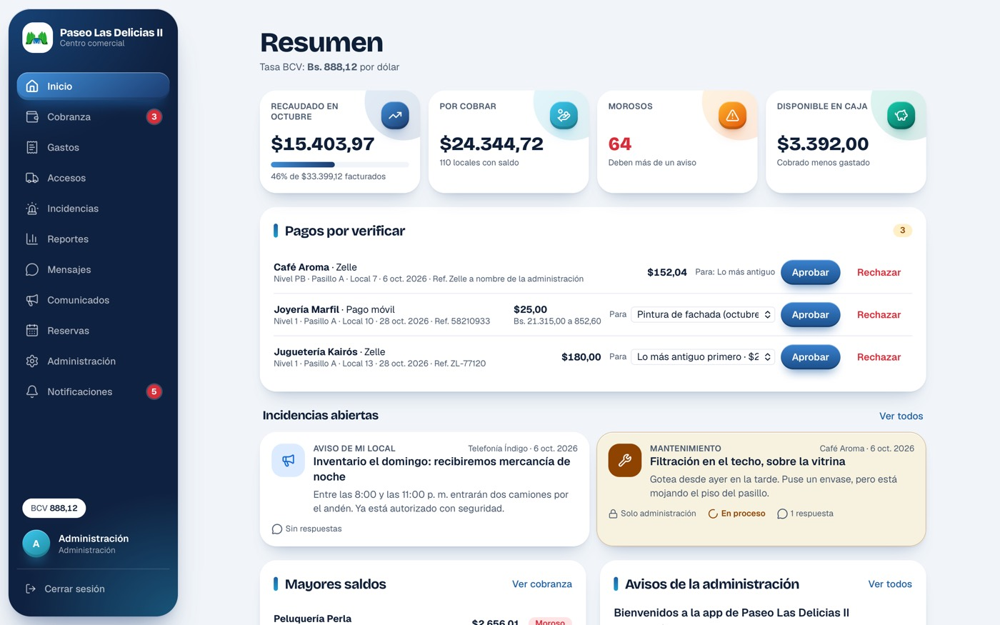
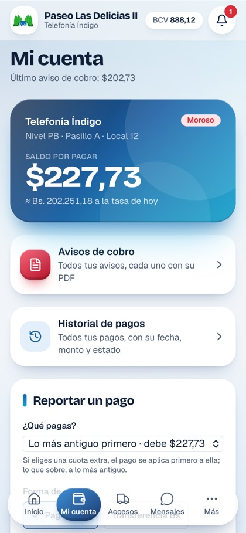
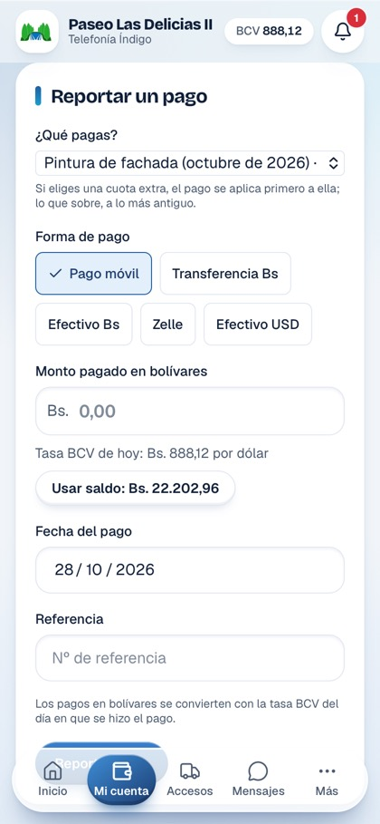
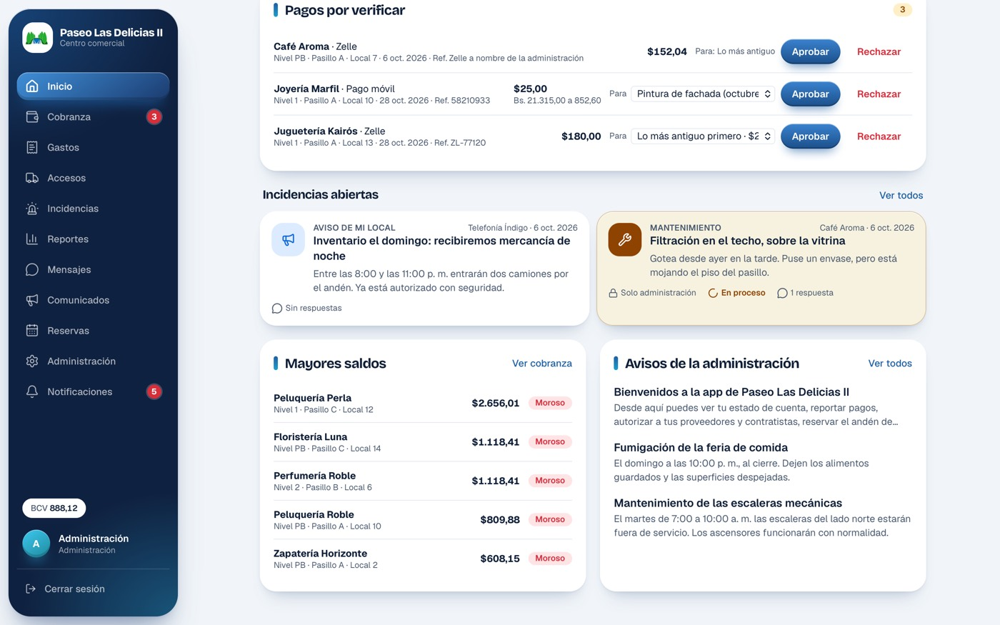
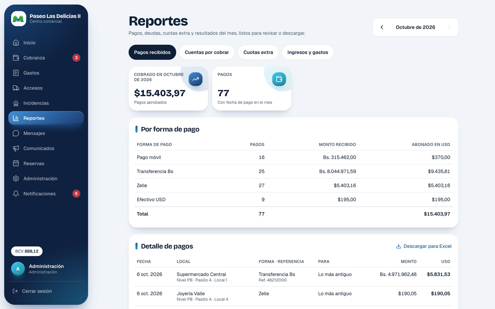
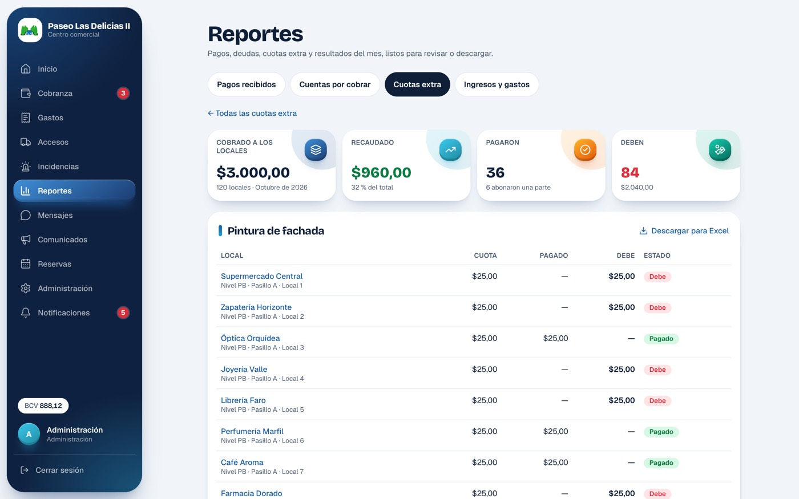

# CondoSmart · Centros comerciales

Aplicación web para administrar el condominio de un centro comercial: aviso de cobro
mensual repartido por alícuota, cobranza por local, cuotas extra, gastos, reportes
administrativos para Excel, control de proveedores y contratistas, incidencias,
comunicados, consultas, reservas, mensajes con la administración y notificaciones. Se
instala en el teléfono como una app (PWA).

- **Demostración en línea:** https://lightgray-whale-964067.hostingersite.com
  (datos ficticios del *Paseo Las Delicias II*, Maracay).
- **Proyecto hermano:** [CondoSmart · Residencial](https://github.com/raulnoguera/condosmart-residencial),
  la versión para urbanizaciones. Comparten la base técnica, pero cada uno tiene su propio
  código, base de datos y sitio.

El código interno conserva el nombre de trabajo **Atrio** (carpetas, `atrio.db`,
`DEPLOY_DIR`). El nombre que ve la gente sale de `lib/brand.ts`; el del centro comercial
se configura en Administración y es el que aparece en el encabezado y en los PDF.

| Administración (computador) | Comerciante (teléfono) |
| --- | --- |
|  |  |

## Contenido

- [Arrancar en local](#arrancar-en-local)
- [Tres vistas](#tres-vistas)
- [Locales](#locales)
- [Aviso de cobro](#aviso-de-cobro)
- [Pagos y a qué se aplican](#pagos-y-a-qué-se-aplican)
- [Reportes administrativos](#reportes-administrativos)
- [Accesos](#accesos)
- [Incidencias](#incidencias)
- [Notificaciones](#notificaciones)
- [Permisos por local](#permisos-por-local)
- [Publicar](#publicar)
- [Estructura del código](#estructura-del-código)

## Arrancar en local

Requiere **Node 24 o superior** (usa `node:sqlite`, sin dependencias nativas).

```bash
npm install
npm run dev
```

Abre http://localhost:3100. La primera vez se crea `data/atrio.db` con datos de
demostración: 120 locales en 4 niveles, varios meses de gastos, avisos de cobro emitidos
y sus pagos. Las cuentas de prueba aparecen en la pantalla de entrada mientras
se corre en modo desarrollo y se entra con un toque, sin contraseña. Están en `lib/seed.ts`:

| Cuenta | Rol |
| --- | --- |
| `admin@condosmart.test` | Administración |
| `comerciante@condosmart.test` | Comerciante al día (Café Aroma) |
| `local12@condosmart.test` | Comerciante con deuda (Telefonía Índigo) |
| `seguridad@condosmart.test` | Seguridad |

Para empezar de cero, detén el servidor, borra `data/atrio.db*` y vuelve a arrancar.

Otros comandos:

```bash
npm test            # pruebas (reparto de pagos)
npm run typecheck   # verificación de tipos
npm run build       # compilación de producción
```

**Probar en un teléfono:** con `npm run dev` corriendo y el teléfono en la misma wifi,
abre `http://<IP-del-computador>:3100`. Todo funciona menos las notificaciones push, que
exigen HTTPS (sirve un túnel temporal como `cloudflared tunnel --url http://localhost:3100`).

## Tres vistas

| Rol | Formato | Qué puede hacer |
| --- | --- | --- |
| Administración (`admin`) | Escritorio, barra lateral | Todo: gastos, avisos de cobro, cobranza, reportes, locales, usuarios, tarifas, aprobar pagos y trabajos, atender incidencias, comunicados |
| Comerciante (`comerciante`) | Teléfono | Estado de cuenta y aviso de su local, reportar pagos, autorizar proveedores y contratistas, reservar, reportar fallas, escribir a la administración, votar |
| Seguridad (`vigilante`) | Teléfono | Accesos del día, registrar entradas y salidas, anotar llegadas sin anunciar, ver incidencias |

Las páginas son las mismas para todos; se adaptan al ancho de su contenedor
(`lib/nav.ts` decide el menú y el formato de cada rol).

## Locales

Cada local se identifica por **nivel + pasillo + número** (`lib/address.ts`) y guarda:

- **Comercio** que opera en él y **propietario** (una persona, una empresa o la promotora).
- **Ocupación:** lo opera su dueño, está alquilado o está desocupado.
- **Alícuota** en porcentaje (p. ej. 0,7245 %): la parte de los gastos del mes que le toca.
  La superficie en m² es solo informativa.
- **Canon mensual**, solo en los locales cuyo alquiler cobra la administración.

En Administración → *Locales* se crea un pasillo completo de una vez o un local suelto, y
se corrigen los datos de cualquiera. Allí mismo se ve cuánto suman las alícuotas cargadas.

## Aviso de cobro

La cobranza sigue el recibo de un condominio comercial venezolano: no hay una cuota fija,
sino que **los gastos reales del mes se reparten entre los locales por alícuota**
(`lib/statement-math.ts`, `lib/statements.ts`).

1. Durante el mes la administración carga en *Gastos* cada partida, en bolívares o en
   dólares, con su código contable y su tipo:
   - **Gasto fijo** (nómina, servicios, mantenimientos contratados) o **gasto eventual**
     (reparaciones, compras): se reparten.
   - **Descuento o aporte** (aporte del hotel o de la feria, alquiler de áreas comunes y
     antenas): es un ingreso del condominio y rebaja lo que se reparte.
   - Si el monto incluye IVA se marca, y el aviso informa aparte la parte exenta, la
     gravable y el IVA.

   Los gastos fijos se definen una vez en *Gastos → Maestro de gastos fijos* y cada mes se
   cargan con **Cargar desde el maestro** o **Copiar los del mes anterior** (ninguno repite
   lo ya cargado). La página de gastos muestra el **total a pagar por los locales**: gastos,
   más fondo de reserva, menos descuentos.
2. En *Cobranza → Emitir aviso de cobro* se ve el borrador del mes y se emite. El aviso
   suma el **fondo de reserva y publicidad** (un porcentaje de los gastos, configurable),
   resta los descuentos y le carga a cada local su alícuota del resultado.
3. El aviso se calcula en bolívares y **la deuda queda fijada en dólares a la tasa BCV del
   día de cálculo**. Queda guardado tal como se emitió: corregir después un gasto no lo cambia.
4. Cada local ve su aviso partida por partida (el total del mes y su parte), la fecha de
   vencimiento y su deuda total.
5. El aviso se descarga en **PDF** con el formato del recibo en papel (`lib/statement-pdf.ts`,
   ruta `/cobranza/aviso/pdf`). El comerciante solo puede sacar el de su local; la
   administración, el de cualquier local y el general. En el teléfono el botón abre la hoja
   de compartir del sistema y en el computador lo descarga (`components/pdf-button.tsx`),
   porque en la app instalada no hay botón de "atrás" para salir de un documento.
6. *Cobranza → Avisos de cobro* (`/cobranza/avisos`) guarda el historial: cada aviso emitido
   con su monto, su estado (pagado, por vencer, vencido) y su PDF.

Además:

- A los locales con **canon** se les carga junto con el aviso.
- Las **cuotas extra** (cargos especiales: pintura de fachada, una reparación mayor) se
  aplican a un local o a todos, y se siguen por separado en los reportes.
- **Moroso** es el local que debe más que el último aviso emitido.
- Las consultas se votan **un voto por local**. Los espacios (andén de carga, salón,
  plaza) se reservan por turno, hasta 60 días antes.

No es un sistema de facturación fiscal: informa el IVA incluido en los gastos, pero no
emite facturas ni maneja retenciones.

## Pagos y a qué se aplican

| Reportar el pago | Pagos por verificar |
| --- | --- |
|  |  |

- Se aceptan pagos en USD (Zelle, efectivo) y en bolívares (pago móvil, transferencia,
  efectivo), convertidos a la **tasa BCV del día del pago**. La tasa se consulta sola una
  vez al día y se puede cargar a mano (`lib/rates.ts`).
- El comerciante **reporta** su pago con la referencia y elige **¿Qué pagas?**:
  - *Lo más antiguo* (por defecto): cubre la deuda de la más vieja a la más nueva.
  - *Cuota mensual*: condominio y canon, sin tocar las cuotas extra.
  - *Una cuota extra en particular*.
- La administración lo **aprueba o rechaza**; al aprobar puede **cambiar el destino**. Solo
  los pagos aprobados descuentan del saldo. El mensaje de aprobación dice qué cubrió el pago,
  cuánto falta de cada cosa y si quedó saldo a favor (`lib/payment-text.ts`).
- La regla del reparto está en `lib/allocation.ts` (`settle`): primero cada pago cubre
  aquello a lo que se destinó; lo que sobra, y los pagos sin destino, van a lo más antiguo.
  Así un local puede estar al día con una cuota extra y deber la mensual, o al revés.
  Está cubierta por `tests/allocation.test.ts`.

## Reportes administrativos

En *Reportes* (`/informes`, solo administración). Cada reporte se descarga en **CSV para
Excel** (separado por punto y coma, coma decimal y con tildes; `app/(app)/informes/csv/route.ts`).

| Reporte | Qué muestra |
| --- | --- |
| **Pagos recibidos** | Pagos aprobados del mes, totales por forma de pago (en dólares y en la moneda en que se pagó) y a qué se aplicó cada uno |
| **Cuentas por cobrar** | Cada local con lo que debe, separado en cuota mensual y cuotas extra, y su estado (al día, pendiente, moroso) |
| **Cuotas extra** | Por cada cuota extra: lo cobrado, lo recaudado y, local por local, si pagó, abonó o debe |
| **Ingresos y gastos** | Los últimos 12 meses: ingresos, aportes, gastos y resultado; y los gastos del mes por categoría |

| Pagos recibidos | Detalle de una cuota extra |
| --- | --- |
|  |  |

Las consultas viven en `lib/reports.ts`.

## Accesos

El local autoriza a quien viene por su cuenta (`lib/access-kinds.ts`): proveedor, carga y
descarga, contratista o visita. Cada acceso tiene un código que la persona da en seguridad.

Los **contratistas** (remodelaciones, electricidad, trabajos fuera de horario) quedan *por
aprobar*: la administración los aprueba o rechaza desde Accesos, y solo entonces el código
sirve y seguridad los ve.

## Incidencias

Cualquier usuario puede reportar (`lib/alert-kinds.ts`), con foto opcional. La sección se
llama *Reportes* para el comerciante y la seguridad, e *Incidencias* para la administración
(para no confundirla con los reportes administrativos).

- **Seguridad, emergencia y avisos del local** se difunden a los demás locales (a todos, o
  solo al nivel o pasillo de quien avisa). Los de seguridad y emergencia se muestran en una
  franja roja en todas las pantallas mientras sigan abiertos, hasta 12 horas.
- **Mantenimiento y limpieza** los ven solo la administración, la seguridad y el local que
  los envió. Pasan por *reportado → en proceso → resuelto* y el local recibe una
  notificación en cada cambio.

## Notificaciones

- Cada acción relevante deja una notificación en el buzón del destinatario (campana) y sale
  como **push** a los dispositivos que la activaron (`lib/notify.ts`, `lib/push.ts`). El
  service worker se sirve desde una ruta de la app (`/sw-push.js`), porque el hosting no
  entrega `.js` sueltos de la carpeta pública.
- Con la app abierta, una notificación nueva aparece como **aviso emergente con sonido**
  durante 15 segundos (`components/notification-alert.tsx`); así la administración ve al
  instante un pago por verificar. El sonido se genera en el navegador, sin archivos.
- Al publicar una versión nueva, todos reciben una notificación con la nota del despliegue
  (`lib/release.ts`) y los teléfonos con la app abierta se actualizan solos
  (`/version`, `components/update-watcher.tsx`).
- Push requiere HTTPS y, en iPhone, tener la app **instalada en la pantalla de inicio**
  (Compartir → Agregar a inicio). Las claves de push se generan solas y viven en la tabla
  `settings`.

## Permisos por local

En Administración → *Permisos por local* se le puede suspender a cada local, o a todos,
cualquiera de estas funciones: reportar pagos, autorizar accesos, reservar, escribir a la
administración y enviar reportes (`lib/privileges.ts`, tabla `unit_restrictions`). El
servidor rechaza la acción aunque se intente por otra vía.

## Publicar

```bash
./scripts/deploy.sh "Qué cambió en esta versión"
```

El script construye un paquete autónomo (`BUILD_STANDALONE=1`), lo sube por SSH, lo activa
y detiene el proceso anterior para que el hosting arranque la versión nueva. La conexión se
lee de `.env.deploy`, que **no se sube al repositorio** (formato en la cabecera del script).
En el servidor quedan:

- `DEPLOY_DIR`: el código (y `DEPLOY_DIR.anterior`, la versión previa, para volver atrás).
- `DEPLOY_DIR-data`: la base de datos, las fotos y `app.log`. **No se toca al publicar y
  hay que respaldarla.**

Variables de entorno (ver `.env.example` y `scripts/server-entry.js`):

| Variable | Para qué |
| --- | --- |
| `DATA_DIR` | Carpeta de la base de datos y las fotos, fuera de la del código |
| `ADMIN_EMAIL`, `ADMIN_PASSWORD` | Si la base está vacía, crean la cuenta de la administración. Cámbiala después desde *Mi perfil* |
| `SEED_DEMO=1` | Carga los datos y cuentas de demostración en producción (así está el sitio de prueba) |
| `DEMO_PASSWORD` | Contraseña de las cuentas de demostración al crear la base. Si falta, se genera una al azar (en el sitio de demostración no hace falta: se entra con un toque). Nunca se escribe en el código |

El sitio debe servirse por **HTTPS**: la sesión usa una cookie segura y las notificaciones
push lo exigen. Probado en hosting compartido de Hostinger (LiteSpeed + Passenger).

## Estructura del código

Next.js 16 (App Router), React 19, Tailwind CSS 4, SQLite con `node:sqlite`, `pdf-lib` para
los PDF y `web-push` para las notificaciones.

```
app/
  (app)/            una carpeta por módulo (cobranza, gastos, informes, accesos, reportes, …)
  actions.ts        todas las escrituras (Server Actions)
  login/            pantalla de entrada
  manifest.ts       la app instalable
  sw-push.js/       service worker de notificaciones
components/         piezas de interfaz compartidas
lib/
  db.ts             esquema y conexión SQLite
  data.ts           consultas de lectura y saldos
  allocation.ts     reparto de pagos entre cargos
  statements.ts     aviso de cobro (statement-math.ts: el cálculo; statement-pdf.ts: el PDF)
  reports.ts        reportes administrativos
  rates.ts          tasa BCV
  auth.ts           sesiones y roles
  notify.ts, push.ts  notificaciones
  seed.ts           datos de demostración
scripts/            despliegue (deploy.sh, server-entry.js)
tests/              pruebas con node:test
docs/capturas/      imágenes de este documento
```

## Licencia

Software privado. Todos los derechos reservados.
